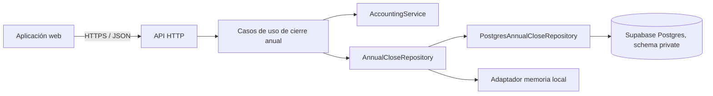

# Arquitectura inicial de la API contable

## Límites y responsabilidades

- `src/modules/accounting` conserva las reglas contables y no depende de HTTP ni de PostgreSQL.
- `src/api/http-server.ts` valida y serializa HTTP con el servidor nativo de Node.
- `src/api/accounting/annual-close.application.ts` coordina preview y confirmación; al confirmar vuelve a construir el cierre desde el snapshot actual.
- `AnnualCloseRepository` es el puerto de persistencia. `PostgresAnnualCloseRepository` escribe en transacciones; `MemoryAnnualCloseRepository` solo sirve para desarrollo sin `DATABASE_URL` y pierde datos al reiniciar.
- Las migraciones versionadas por Supabase están en `supabase/migrations`. La migración contable crea tablas privadas, habilita RLS, revoca acceso desde roles de cliente y avanza la revisión cuando cambia el libro o el estado mensual.

## Endpoints iniciales

- `GET /health`: disponibilidad del proceso.
- `POST /api/accounting/annual-close/preview`: recibe empresa y ejercicio; devuelve asientos, validaciones y `revision`.
- `POST /api/accounting/annual-close/confirm`: recibe `expectedRevision`; devuelve `409` si el libro cambió desde el preview o el ejercicio ya fue cerrado.

La API limita JSON a 32 KiB, no almacena respuestas en caché y escucha en `127.0.0.1` por defecto. Toda ruta exige sesión de usuario y cada ruta de empresa verifica el rol del usuario en esa empresa (ver `docs/usuarios-y-permisos.md`). Fuera de localhost debe publicarse detrás de HTTPS.

## Desarrollo

1. Copia `.env.example` a `.env` y agrega `DATABASE_URL` desde Supabase > **Connect**. No compartas ese valor ni lo subas a Git.
2. Ejecuta `npm.cmd run api:dev`.
3. Comprueba `GET http://127.0.0.1:3000/health`.

Para aplicar el esquema en una instancia local de Supabase, inicia Docker Desktop y ejecuta `npx.cmd supabase start` y luego `npx.cmd supabase db reset`. Para enlazar el proyecto remoto, usa `npx.cmd supabase login` y `npx.cmd supabase link --project-ref <project-ref>`; revisa siempre `npx.cmd supabase db push --dry-run --remote` antes de ejecutar `npx.cmd supabase db push --remote`.

Sin `DATABASE_URL`, la API usa memoria y el preview vacío aparece bloqueado. Con PostgreSQL, aún falta integrar la escritura de los asientos operativos para que el preview consulte el libro real.

## Ruta a producción

1. Conectar los flujos que crean asientos operativos al repositorio PostgreSQL para que todas las modificaciones actualicen la revisión.
2. Implementar autenticación y derivar de la sesión la empresa autorizada; no confiar en `companyId` del navegador.
3. Integrar la pantalla con estos endpoints y servir UI/API bajo el mismo origen o configurar CORS explícito.
4. Probar transacciones, concurrencia, idempotencia y recuperación en staging antes de producción.
